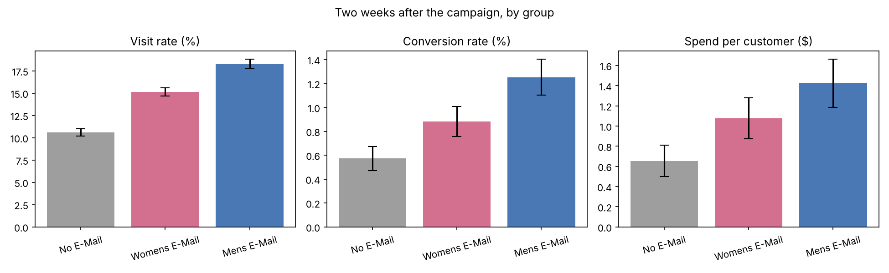

# E-commerce Email A/B Test Analysis

Analysis of a randomized email experiment with 64,000 customers: do marketing emails increase site visits,
purchases and revenue, which customers respond to which email, and who should receive which email in future?

## Key findings

- **Both emails work.** Compared with no email, the men's email raised the visit rate from 10.6% to 18.3%, roughly
  doubled conversion (0.57% → 1.25%) and added about $0.77 of spend per customer over two weeks. The women's
  email had about half that effect.
- **More buyers, not bigger orders.** Average order value was about the same in every group (no significant difference); the revenue gain comes
  from more customers buying.
- **The men's email works for everyone; the women's email works mainly on women's buyers.** For customers who had bought only men's
  products, the women's email barely moved visits (+1 pt vs +7 pts for the men's email).
- **A machine-learning uplift model did not beat a simple rule.** It rediscovered the same pattern, but as a
  targeting strategy it performed no better than "men's email by default, women's email for women's-only buyers".



## Recommendation

Use the men's email as the default. The women's email can be kept for customers who buy only women's products
(no measurable difference in results), but should not be sent to men's-only buyers. Confirm with a follow-up test before rollout.

## Methods

| Question | Method |
|---|---|
| Was the experiment properly randomized? | Balance check: standardized mean differences, ANOVA, chi-square |
| Did the emails increase visits and conversions? | Two-proportion z-test with 95% confidence intervals |
| Did they increase spend? | Bootstrap confidence intervals (spend is ~99% zeros) |
| Which customers respond? | Subgroup analysis in SQL (DuckDB), Bonferroni correction, forest plot |
| Can a model target better? | T-learner uplift model (gradient boosting), decile and Qini evaluation, policy comparison with inverse propensity weighting |

## Repository structure

```
├── data/
│   ├── data.csv                  # raw data
│   └── data_clean.csv            # created by analysis.ipynb
├── notebooks/
│   ├── analysis.ipynb            # data check, A/B test, segments, recommendation
│   └── uplift_modeling.ipynb     # uplift model vs simple targeting rule
├── outputs/                      # charts and data dictionary
└── requirements.txt
```

## How to run

```bash
pip install -r requirements.txt
jupyter notebook
```

Run `analysis.ipynb` first (it creates `data/data_clean.csv`), then `uplift_modeling.ipynb`.

## Data

Kevin Hillstrom, *MineThatData E-Mail Analytics and Data Mining Challenge* (2008). 64,000 customers who purchased
within the last 12 months were randomly assigned to receive a men's merchandise email, a women's merchandise
email, or no email, and were tracked for two weeks.
